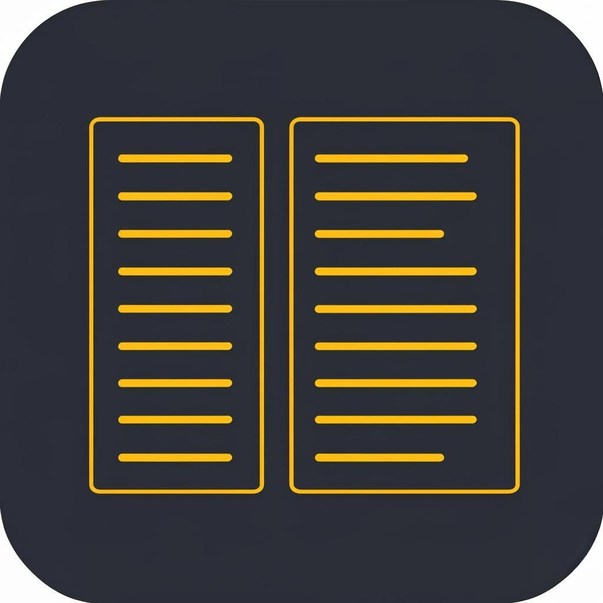

# Rust Commander

<p align="center">
  
</p>

A **Total Commander-style dual-pane file manager** with a built-in **utility toolbox**, written in 100% Rust. Runs natively on **Windows** and **macOS** (and builds on Linux too).

[](https://github.com/CJ-1981/rust-commander/actions/workflows/ci.yml)

## Features

### File navigation (dual pane)

- Two independent directory panels with an active-panel highlight
- Single click selects, Ctrl+Click adds to the selection, Shift+Click selects a range, Insert/Space toggles selection at the cursor
- Sort by name, size, modification date or extension - click the column headers
- Editable path bar, Home button, drive/volume picker (Windows drive letters, macOS `/Volumes`), refresh, hidden-file toggle
- Built-in text viewer (F3) and editor (F4) with save (Ctrl+S)
- Open any file with its system default application (double-click or menu)
- Active panel is operated with Total Commander-style keyboard shortcuts

### File operations (background threads with progress + cancel)

- **F5** Copy selection to the opposite panel
- **F6** Move selection to the opposite panel, **Shift+F6** rename
- **F7** New folder
- **F8/Delete** Delete selection (permanent, with confirmation dialog)
- Recursive copy/move/delete of folder trees; fast rename on the same volume, copy+delete fallback across volumes
- All long operations run on worker threads with live progress in the status bar and a Stop button

### Utility toolbox

- **Hash calculator**: MD5 + SHA-256 streamed in chunks, with progress bar and copy-to-clipboard
- **File search**: recursive name search (case-insensitive substring), live progress, capped results
- **Duplicate finder**: content-based duplicate detection (group by size, then hash), wasted-space summary
- **System info**: OS, kernel, CPU, memory and all mounted disks with free/total space

## Keyboard shortcuts

| Key | Action |
| --- | --- |
| Tab | Switch active panel |
| Up / Down | Move cursor |
| Home / End | First / last entry |
| Enter | Open folder / view file |
| Backspace | Go to parent folder |
| Insert / Space | Toggle selection at cursor |
| Ctrl+Click | Add to selection |
| Shift+Click | Range selection |
| Double-click | Enter folder / open file with system app |
| F3 | View file (read-only) |
| F4 | Edit file |
| F5 | Copy to opposite panel |
| F6 | Move to opposite panel |
| Shift+F6 | Rename |
| F7 | New folder |
| F8 / Delete | Delete selection |
| Ctrl+S | Save file in editor |
| Esc | Close dialog |

## Build

Prerequisites: [Rust](https://rustup.rs) 1.77 or newer.

```sh
cargo build --release
```

The binary is written to `target/release/rust-commander` (`rust-commander.exe` on Windows).

Run it directly during development:

```sh
cargo run --release
```

## Platform notes

- **Windows**: drive letters A-Z are auto-detected in the Drives menu.
- **macOS**: mounted volumes appear via `/Volumes`. The `.app` bundles produced by CI are ad-hoc signed (no Apple Developer ID), so macOS shows an "unidentified developer" warning on first launch. Right-click > Open once, or approve under System Settings > Privacy & Security > "Open Anyway". If macOS reports the app as "damaged", clear the download quarantine flag:
  ```sh
  xattr -cr "Rust Commander.app"
  ```
- **Delete is permanent** (no recycle bin) - the confirmation dialog exists for a reason.

## CI / Releases

GitHub Actions (`.github/workflows/ci.yml`) builds release binaries on every push and pull request for:

| Target | Runner | Artifact |
| --- | --- | --- |
| `x86_64-pc-windows-msvc` | `windows-latest` | `RustCommander-windows-x64.zip` |
| `aarch64-apple-darwin` | `macos-latest` | `RustCommander-macos-arm64.zip` (`.app` bundle) |
| `x86_64-apple-darwin` | `macos-latest` | `RustCommander-macos-x64.zip` (`.app` bundle) |

Artifacts are attached to every CI run; pushing a tag like `v0.1.0` additionally publishes a GitHub Release with all three artifacts attached.

### Cut a new release

Releases are fully automated - one command publishes new binaries:

```sh
git tag v0.1.3
git push origin v0.1.2
```

The pipeline then builds all three targets, packages them (macOS `.app` bundles with an auto-generated icon, Windows zip), and creates the GitHub Release with the binaries attached. The version inside the macOS bundle metadata is synced automatically from the pushed tag.

## License

MIT - see [LICENSE](LICENSE).
